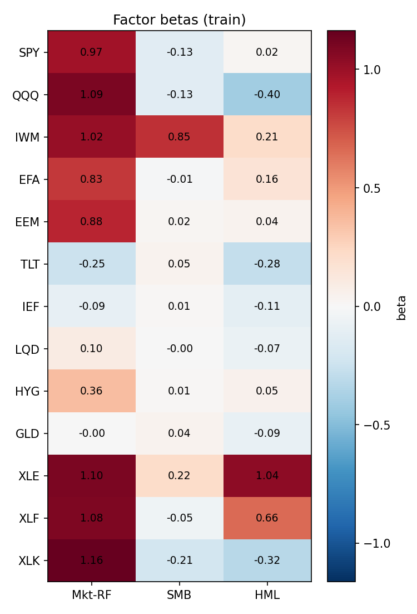
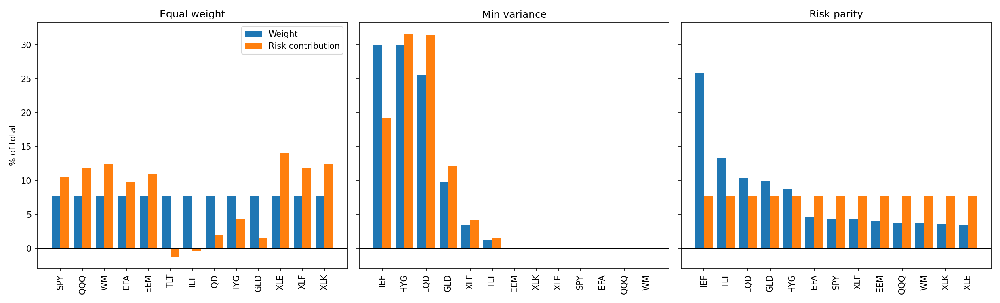
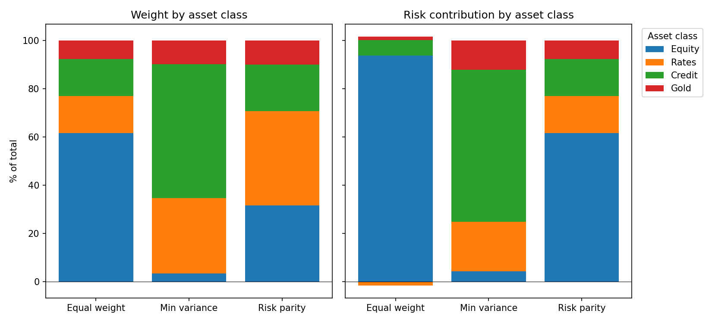
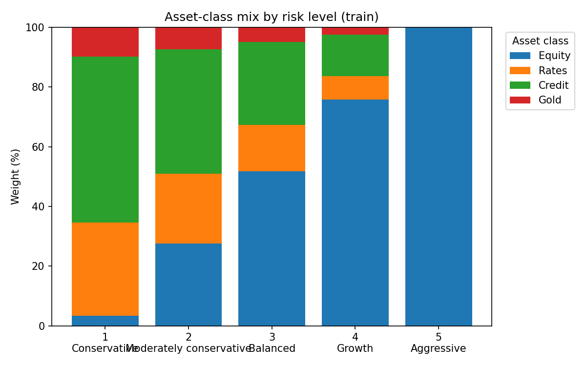
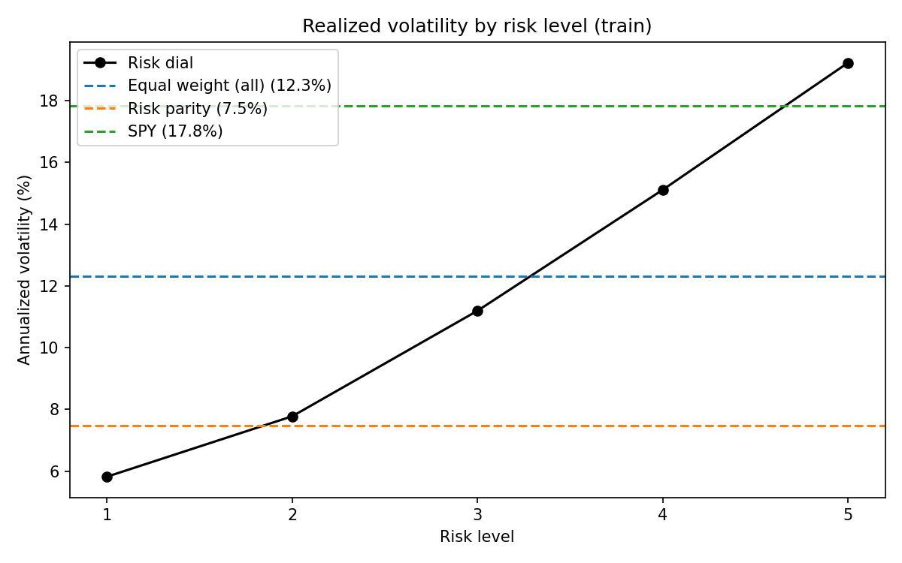
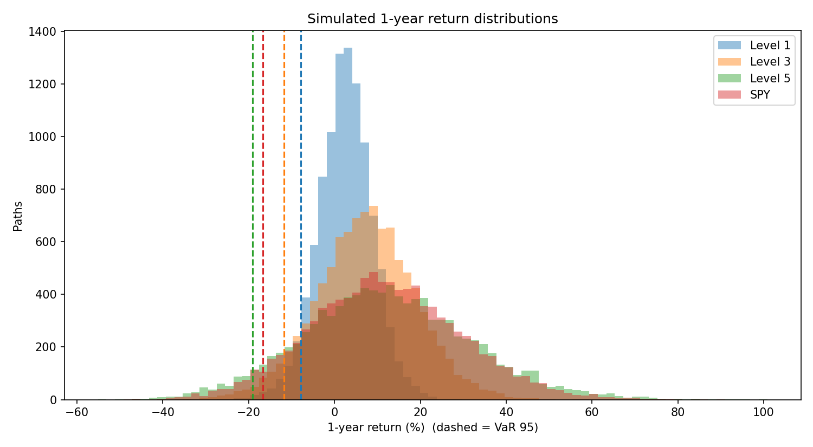
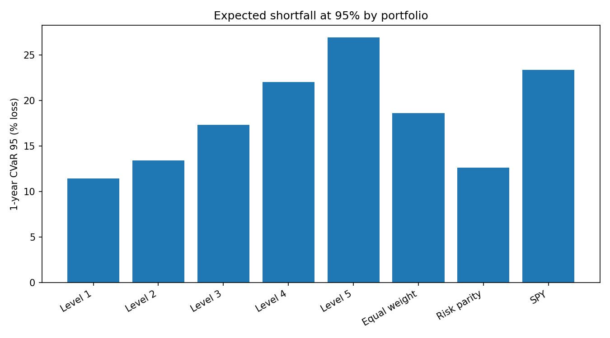
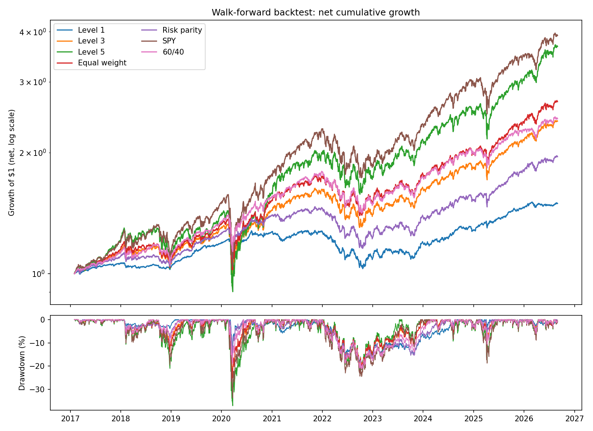
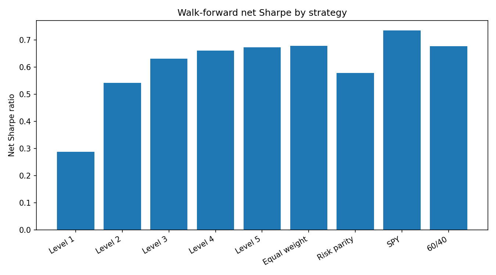
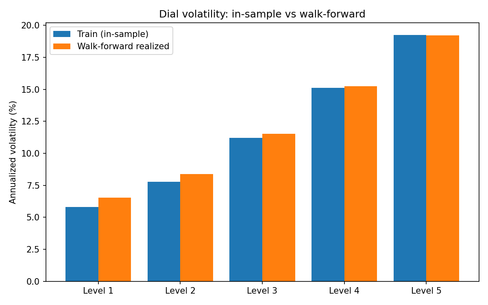

# Factor-Based Portfolio Risk and Allocation Engine

A Python engine that takes a universe of 13 liquid ETFs and turns it into risk-aware allocations. It measures each ETF's
**Fama-French factor exposures**, estimates a **Ledoit-Wolf shrunk covariance** matrix, builds **min-variance and risk-parity**
portfolios, maps a user-chosen **1-5 risk dial** onto a blend of a conservative and a growth anchor, quantifies tail risk with a
**block bootstrap** (VaR and CVaR, factor exposures and market stress, plus historical scenario replays), and finally tests the
dial and its benchmarks in a **walk-forward backtest** with drifting weights and transaction costs. Every phase prints PASS/FAIL
sanity checks, and all results are written to `outputs/`.


## Quick start

```bash
pip install -r requirements.txt
python run_all.py                  # runs Phases 1-7 in order and prints the checks passed for each
python run_phase5.py --level 3     # one risk-dial portfolio (any level from 1 to 5, decimals allowed)
python recommend.py --level 3      # the current allocation for a risk level (see Current allocation)
pytest                             # fast unit tests, no network needed
```

`python run_all.py --refresh` deletes the cached downloads first so the data is downloaded again (results will then reflect the newest data).

## Data

- **Universe** (from `config.py`):
  - Equity: SPY, QQQ, IWM, EFA, EEM, XLE, XLF, XLK
  - Rates: TLT, IEF
  - Credit: LQD, HYG
  - Gold: GLD
- **Prices:** adjusted close prices from Yahoo Finance via `yfinance` (requested from 2014-01-01).
- **Factors:** Ken French daily Fama-French 3-factor file (`F-F_Research_Data_Factors_daily`; Mkt-RF, SMB, HML, RF), converted from percent to decimals.
- **Sample:** simple daily returns on the dates where both sources have data. The first return date is 2014-01-03 (`outputs/residuals.parquet`)
  and the last is 2026-08-31 (`outputs/daily_returns_phase7.parquet`).
- **Train/test split (Phases 2-6):** by date order, never random. The first 70% of days is the train set: 2014-01-03 to 2022-11-07
  (2,228 days). Everything in Phases 2-6 is fitted on the train set only.
- **Walk-forward (Phase 7):** does not use the split. It uses the full sample with a rolling 756-day window. The first
  rebalance is 2017-01-31, the evaluation period is 2017-02-01 to 2026-08-31 (2,408 trading days), with 115 monthly rebalances.

## Methodology

**Phase 1 - Data pipeline** (`data.py`, `run_phase1.py`). Download and cache prices and factors, compute simple returns, subtract RF
to get excess returns, inner-join on dates (dropping rows with NaN and logging how many), and split chronologically. Sanity checks
cover NaNs, aligned indexes, factor scale, SPY volatility, TLT/SPY correlation and train-before-test ordering.

**Phase 2 - Factor regressions** (`models.py`, `run_phase2.py`). For each ETF, OLS on the train set:
`r_i,t - rf_t = alpha_i + b_i,mkt (Mkt-RF)_t + b_i,smb SMB_t + b_i,hml HML_t + e_i,t`, with Newey-West (HAC) standard errors
using 5 lags. Annualized alpha is daily alpha x 252. Residuals are saved for the bootstrap.

**Phase 3 - Covariance and allocation** (`models.py`, `run_phase3.py`). Covariance is the Ledoit-Wolf estimate of the train
simple returns (daily). Three strategies: equal weight (1/N); **min-variance**, minimizing `w'Σw` subject to
`sum(w) = 1` and `0 <= w_i <= 0.3` (SLSQP); and **risk parity**, long-only with no cap, minimizing
`sum_i (rc_i - 1/N)^2` from an inverse-volatility start.

**Phase 4 - Risk contribution analysis** (`models.py`, `run_phase4.py`). The fractional risk contribution of asset i is
`rc_i = w_i (Σw)_i / (w'Σw)`, which sums to 1. The risk-to-weight ratio is `rc_i / w_i`. Contributions are summed within
asset classes (Equity, Rates, Credit, Gold) using the map in `config.py`.

**Phase 5 - Risk dial** (`models.py`, `run_phase5.py`). The conservative anchor (level 1) is the capped min-variance portfolio; the growth
anchor (level 5) is equal weight across the equity ETFs only. For any level in [1, 5]:
`w(level) = (1 - a) * w_conservative + a * w_growth`, with `a = (level - 1) / 4`. No target volatility is hardcoded: the realized
volatility of each level is reported from the data. Levels outside [1, 5] raise a `ValueError`.

**Phase 6 - Tail risk** (`simulate.py`, `run_phase6.py`). Simulated daily excess returns are reconstructed from the Phase 2 model as
`factors @ betas + residuals`, with alpha deliberately excluded so period alpha is not baked in. A **circular block bootstrap** draws
10,000 paths of 252 days from random start dates, taking consecutive blocks of 10 days
(wrapping around the end of the sample); the same dates supply excess returns and RF. Portfolio weights are held constant (daily
rebalanced) and the 1-year return is `prod(1 + r_t) - 1` with `r_t` the portfolio's excess return plus RF. **VaR** at level
alpha is `-quantile_(1-alpha)(R)` and **CVaR** is `-mean(R | R <= quantile_(1-alpha))`, both reported as positive losses at
95%, 99%. Portfolio factor exposures are `weights @ betas`. The linear market stress is
`market beta x shock` for shocks of -10%, -20%, a one-factor approximation. The scenario
replay applies the fixed train-fit weights to actual daily total returns (excess + RF) over COVID crash (2020-02-19 to 2020-03-23), 2022 full year (2022-01-03 to 2022-12-30).
It is a historical replay, not a forecast.

**Phase 7 - Walk-forward backtest** (`backtest.py`, `run_phase7.py`). Rebalances happen on the last trading day of each month.
At rebalance date `t`, only returns with index `<= t` over the trailing 756 observations are used to compute the
Ledoit-Wolf covariance and the target weights; the weights are applied from `t + 1` onward and never to a return on or before `t`.
The first rebalance is the first month-end with at least 756 observations. Between rebalances weights **drift** with
returns. At each rebalance the traded amount is `sum |target - drifted weights|` (the initial purchase trades the whole
portfolio) and the cost is `bps / 10,000 x traded amount`, deducted from the return on the first day of the new holding
period; the base case is 5 bps. Strategies: dial levels 1-5 (recomputed at every rebalance), equal weight, risk
parity, SPY buy-and-hold (no rebalancing trades) and 60/40 (SPY 60% / IEF 40%,
rebalanced monthly). Sharpe is computed on daily excess returns over RF; turnover is one-way and excludes the initial purchase. A
look-ahead test reruns the backtest on truncated data and checks that earlier weights and returns do not change.

## Results

All tables are copied from the files in `outputs/`; values are rounded for display only.

### Factor exposures (train)

| Ticker | Ann. alpha | Mkt-RF | SMB | HML | R² |
|---|---|---|---|---|---|
| SPY | 0.31% | 0.97 | -0.13 | 0.02 | 0.995 |
| QQQ | 2.92% | 1.09 | -0.13 | -0.40 | 0.944 |
| IWM | -1.75% | 1.02 | 0.85 | 0.21 | 0.983 |
| EFA | -5.97% | 0.83 | -0.01 | 0.16 | 0.764 |
| EEM | -7.15% | 0.88 | 0.02 | 0.04 | 0.598 |
| TLT | 4.16% | -0.25 | 0.05 | -0.28 | 0.168 |
| IEF | 1.37% | -0.09 | 0.01 | -0.11 | 0.141 |
| LQD | 0.22% | 0.10 | -0.00 | -0.07 | 0.066 |
| HYG | -1.86% | 0.36 | 0.01 | 0.05 | 0.604 |
| GLD | 3.45% | -0.00 | 0.04 | -0.09 | 0.008 |
| XLE | -2.31% | 1.10 | 0.22 | 1.04 | 0.666 |
| XLF | -0.07% | 1.08 | -0.05 | 0.66 | 0.912 |
| XLK | 4.35% | 1.16 | -0.21 | -0.32 | 0.923 |



### Risk contributions by asset class (train)

| Strategy | Asset class | Weight | Risk contribution | Risk / weight |
|---|---|---|---|---|
| Equal weight | Equity | 61.5% | 93.8% | 1.52 |
| Equal weight | Rates | 15.4% | -1.6% | -0.11 |
| Equal weight | Credit | 15.4% | 6.4% | 0.41 |
| Equal weight | Gold | 7.7% | 1.5% | 0.19 |
| Min variance | Equity | 3.4% | 4.2% | 1.23 |
| Min variance | Rates | 31.2% | 20.7% | 0.66 |
| Min variance | Credit | 55.5% | 63.0% | 1.13 |
| Min variance | Gold | 9.8% | 12.1% | 1.23 |
| Risk parity | Equity | 31.5% | 61.5% | 1.95 |
| Risk parity | Rates | 39.3% | 15.4% | 0.39 |
| Risk parity | Credit | 19.2% | 15.4% | 0.80 |
| Risk parity | Gold | 10.0% | 7.7% | 0.77 |





### Risk dial (train)

| Level | Label | Train vol | Equity | Rates | Credit | Gold | Largest position |
|---|---|---|---|---|---|---|---|
| 1 | Conservative | 5.8% | 3.4% | 31.2% | 55.5% | 9.8% | IEF 30.0% |
| 2 | Moderately conservative | 7.8% | 27.5% | 23.4% | 41.7% | 7.4% | IEF 22.5% |
| 3 | Balanced | 11.2% | 51.7% | 15.6% | 27.8% | 4.9% | IEF 15.0% |
| 4 | Growth | 15.1% | 75.8% | 7.8% | 13.9% | 2.5% | XLF 10.2% |
| 5 | Aggressive | 19.2% | 100.0% | 0.0% | 0.0% | 0.0% | SPY 12.5% |





### Simulated 1-year returns (VaR and CVaR are positive losses)

| Portfolio | Mean | VaR 95 | CVaR 95 | VaR 99 | CVaR 99 | P(loss) | Worst |
|---|---|---|---|---|---|---|---|
| Level 1 | 2.5% | 7.9% | 11.5% | 13.8% | 16.9% | 32.8% | -26.9% |
| Level 2 | 4.9% | 8.9% | 13.4% | 16.2% | 20.1% | 26.2% | -31.6% |
| Level 3 | 7.4% | 11.8% | 17.3% | 21.1% | 25.4% | 24.9% | -40.2% |
| Level 4 | 9.9% | 15.4% | 22.0% | 26.2% | 31.3% | 25.6% | -48.0% |
| Level 5 | 12.3% | 19.0% | 26.9% | 31.6% | 37.3% | 26.5% | -55.1% |
| Equal weight | 8.0% | 12.8% | 18.6% | 22.4% | 27.1% | 25.4% | -42.8% |
| Risk parity | 4.3% | 8.8% | 12.6% | 15.0% | 18.6% | 28.9% | -29.2% |
| SPY | 12.0% | 16.6% | 23.4% | 27.8% | 33.0% | 25.4% | -47.3% |





### Linear market stress vs historical scenario replay

| Portfolio | Linear: market -10% | Linear: market -20% | Replay: COVID crash | Replay: 2022 full year |
|---|---|---|---|---|
| Level 1 | -1.4% | -2.8% | -10.0% | -13.1% |
| Level 2 | -3.6% | -7.2% | -17.2% | -12.6% |
| Level 3 | -5.8% | -11.6% | -24.1% | -12.4% |
| Level 4 | -8.0% | -16.0% | -30.7% | -12.3% |
| Level 5 | -10.2% | -20.3% | -36.9% | -12.4% |
| Equal weight | -6.3% | -12.7% | -25.1% | -13.1% |
| Risk parity | -3.0% | -6.0% | -12.8% | -14.8% |
| SPY | -9.7% | -19.5% | -33.4% | -18.2% |

The linear columns are a market-beta-only approximation and ignore rates and credit risk. The replay columns use the fixed train-fit
weights on actual returns and are not out-of-sample (both windows fall inside or overlap the train period).

### Walk-forward performance (2017-02-01 to 2026-08-31, net of 5 bps costs)

| Strategy | CAGR | Vol | Sharpe | Max DD | Turnover / yr | Cost drag | 1-day VaR 95 | 1-day CVaR 95 | Worst full year |
|---|---|---|---|---|---|---|---|---|---|
| Level 1 | 4.3% | 6.5% | 0.29 | -19.7% | 17.5% | 0.02% | 0.63% | 0.97% | -14.4% |
| Level 2 | 7.0% | 8.4% | 0.54 | -19.6% | 18.4% | 0.03% | 0.75% | 1.24% | -13.7% |
| Level 3 | 9.6% | 11.5% | 0.63 | -25.0% | 18.4% | 0.03% | 1.05% | 1.72% | -13.1% |
| Level 4 | 12.1% | 15.2% | 0.66 | -31.2% | 16.9% | 0.02% | 1.37% | 2.28% | -12.7% |
| Level 5 | 14.6% | 19.2% | 0.67 | -37.1% | 14.6% | 0.02% | 1.75% | 2.88% | -12.4% |
| Equal weight | 10.9% | 12.6% | 0.68 | -25.2% | 15.8% | 0.02% | 1.15% | 1.88% | -13.3% |
| Risk parity | 7.3% | 8.3% | 0.58 | -21.3% | 15.2% | 0.02% | 0.78% | 1.23% | -15.5% |
| SPY | 15.3% | 18.2% | 0.74 | -33.7% | 0.0% | 0.01% | 1.70% | 2.78% | -18.2% |
| 60/40 | 9.7% | 10.8% | 0.68 | -21.3% | 10.2% | 0.02% | 1.02% | 1.64% | -16.7% |

### Cost sensitivity (net Sharpe)

| Strategy | Sharpe at 0 bps | Sharpe at 5 bps | Sharpe at 10 bps |
|---|---|---|---|
| Level 1 | 0.29 | 0.29 | 0.28 |
| Level 2 | 0.55 | 0.54 | 0.54 |
| Level 3 | 0.63 | 0.63 | 0.63 |
| Level 4 | 0.66 | 0.66 | 0.66 |
| Level 5 | 0.67 | 0.67 | 0.67 |
| Equal weight | 0.68 | 0.68 | 0.68 |
| Risk parity | 0.58 | 0.58 | 0.58 |
| SPY | 0.74 | 0.74 | 0.73 |
| 60/40 | 0.68 | 0.68 | 0.68 |







## Key findings

- **Equal weight is an equity bet in risk terms.** Equity is 61.5% of capital in the equal-weight portfolio but 93.8% of its risk (risk/weight 1.52); rates contribute -1.6% of risk on 15.4% of capital.
- **The dial's realized volatility tracks its in-sample volatility.** level 1: 5.8% in-sample, 6.5% walk-forward; level 2: 7.8% in-sample, 8.4% walk-forward; level 3: 11.2% in-sample, 11.5% walk-forward; level 4: 15.1% in-sample, 15.2% walk-forward; level 5: 19.2% in-sample, 19.2% walk-forward. Realized volatility rises at every level, from 6.5% to 19.2%.
- **SPY has the highest Sharpe in the walk-forward period** (0.74, CAGR 15.3%, max drawdown -33.7%). The next highest are Equal weight (0.68) and 60/40 (0.68). No dial level beat SPY on Sharpe; the dial's value in this sample is the lower drawdown at the conservative end (level 1 max drawdown -19.7%), not higher risk-adjusted return.
- **60/40 versus level 3.** 60/40 had CAGR 9.7%, volatility 10.8%, Sharpe 0.68 and max drawdown -21.3%; level 3 had CAGR 9.6%, volatility 11.5%, Sharpe 0.63 and max drawdown -25.0%. The simple 60/40 mix had the higher CAGR and Sharpe ratio and the lower volatility and drawdown.
- **Level 1 in 2022, and its credit concentration.** In the 2022 replay, level 1 lost 13.1% (SPY 18.2%), and its worst full walk-forward calendar year was -14.4%, worse than levels 2 to 5 (worst of those: -13.7%). The conservative anchor is the min-variance portfolio: credit is 55.5% of its capital and 63.0% of its risk, with 30.0% in IEF and 30.0% in HYG at the 30% cap. With only 3.4% in equity, that 2022 loss came from its rates, credit and gold holdings.
- **Probability of loss is not monotone across levels.** Simulated 1-year probability of loss is 32.8% at level 1, 26.2% at level 2, 24.9% at level 3, 25.6% at level 4, 26.5% at level 5 (SPY 25.4%). Level 1 is the most likely to lose money even though its VaR 95 (7.9%) is the smallest, because its simulated mean 1-year return (2.5%) is small relative to its risk, while level 5's is 12.3%. Return per unit of risk differs across asset classes, so loss probability does not rise with the dial.
- **The linear market stress understates the COVID crash for the conservative end.** A -20% market shock implies -2.8% for level 1, but replaying 2020-02-19 to 2020-03-23 gives -10.0%; for SPY the linear estimate is -19.5% against a replay of -33.4%.
- **Transaction costs are small at monthly rebalancing.** Cost drag is at most 0.03% of CAGR per year across strategies, and moving from 0 to 10 bps changes net Sharpe by at most 0.01 (for example level 1: 0.29 to 0.28).

## Current allocation

```bash
python recommend.py --level 3 [--asof 2026-07-31] [--refresh]
```

`recommend.py` turns the risk dial into today's allocation. It takes the trailing 756 trading days of returns ending on the
as-of date (default: the last price date; only data on or before that date is used), fits the Ledoit-Wolf covariance, builds the
dial portfolio for the requested level, and compares it with the same allocation as of the previous month-end. It prints the
asset-class split, the ETF weights, the annualized volatility and risk shares, the portfolio's Fama-French exposures and its
1-year 95% VaR and CVaR, then runs its checks. It also saves `outputs/current_allocation_level<L>.csv` and
`outputs/allocation_history_level<L>.png` (the asset-class split of the stored Phase 7 walk-forward weights over time).
`--refresh` clears the cached downloads and fetches fresh data.

The tail risk is the Phase 6 block bootstrap (same settings, weights held fixed), run twice. The **full-history** estimate resamples every
aligned day from the start of the dataset through the as-of date (limited to the last Ken French date, because the factor model
needs factors) and is the **primary risk estimate**. The **last-3-years** estimate uses only the trailing window. The two differ because
the full history contains the 2020 crash and the 2022 selloff, while the last three years do not, so the recent-window number can show little
or no loss at the 5th percentile and understates risk when the window was calm. The Ken French file lags the prices, so the factor
regressions and both bootstraps use only days that have factor data (the printed notes give the dates and day counts).

Two checks compare against stored results: the allocation as of the last Phase 7 rebalance must equal the stored Phase 7 weights (levels 1,
3 and 5), and the full-history VaR and CVaR for level 5 as of the end of the train period must equal the Phase 6 level 5 values. After
`--refresh`, re-run `python run_all.py` before expecting those two checks to pass.

Example output (`python recommend.py --level 3`, data through 2026-10-23):

```
=== CURRENT ALLOCATION: LEVEL 3 (Balanced) ===
As of:            2026-10-23
Window:           2023-10-19 -> 2026-10-23 (756 trading days)
Last month-end:   2026-09-30 (used for the change columns)

--- Asset-class split ---
             weight %  last month %  change (pp)
asset_class                                     
Equity           54.0          54.2         -0.2
Rates            15.0          15.0          0.0
Credit           29.9          29.7          0.2
Gold              1.1           1.1          0.0

--- ETF weights (rows with a non-zero weight now or last month) ---
        weight %  last month %  change (pp)
Ticker                                     
SPY          6.2           6.3          0.0
QQQ          6.2           6.2          0.0
IWM          6.2           6.3          0.0
EFA          6.2           6.2          0.0
EEM          6.2           6.2          0.0
IEF         15.0          15.0          0.0
LQD         14.9          14.7          0.2
HYG         15.0          15.0          0.0
GLD          1.1           1.1          0.0
XLE          9.8           9.8          0.0
XLF          6.7           6.9         -0.2
XLK          6.2           6.2          0.0

Annualized volatility of this allocation over the window: 9.3%
Share of risk by asset class: Equity 82.9%, Rates 3.2%, Credit 13.1%, Gold 0.8%

--- 1-year tail risk (block bootstrap: 10,000 paths x 252 days, block 10, seed 42; weights held fixed) ---
Full history (2014-01-03 to 2026-08-31, 3,183 days)  [primary risk estimate]
    95% VaR: 9.6%   95% CVaR: 15.4%   5th-percentile 1-year return: -9.6%
Last 3 years only (2023-10-19 to 2026-08-31, 718 days)  [recent regime; understates risk when the window was calm]
    95% VaR: no loss at the 5th percentile   95% CVaR: 3.2%   5th-percentile 1-year return: +0.8%

Factor exposures (Fama-French regressions on the last-3-years sample): Mkt-RF 0.57   SMB 0.07   HML 0.10
That sample is the 718 of 756 window days that have Ken French data.
Last factor observation: 2026-08-31 (Ken French data lags prices; last price date 2026-10-23)

Risk-targeted allocation based on the past 3 years; not a return forecast and not investment advice.

Saved: outputs/current_allocation_level3.csv, outputs/allocation_history_level3.png

=== CHECKS ===
[PASS] weights sum to 1, are all >= 0, and none exceeds MAX_WEIGHT  (sum = 1.0000000000, min = 9.66e-18, max = 0.1500)
[PASS] last return date used is on or before the as-of date, and exactly WINDOW_DAYS observations  (last used 2026-10-23 <= 2026-10-23, 756 observations)
[PASS] asset-class split sums to 100% and the ETF weights roll up to it exactly  (split sums to 100.00%, max roll-up diff 0.0e+00)
[PASS] changes vs last month sum to zero across ETFs  (sum of changes = -3.47e-17)
[PASS] consistency: allocation as of the last Phase 7 rebalance (2026-07-31) equals the stored Phase 7 weights for levels 1, 3 and 5 (max abs diff < 1e-8)  (max abs diff by level: 0.0e+00, 0.0e+00, 0.0e+00)
[PASS] full-history 95% VaR and CVaR for level 5 as of 2022-11-07 (end of the train period) equal the Phase 6 level 5 values (within 1e-6)  (VaR 0.19043190 vs 0.19043190, CVaR 0.26924991 vs 0.26924991)

6/6 checks passed.
```

> Risk-targeted allocation based on the past 3 years; not a return forecast and not investment advice.

## Limitations

1. **The bootstrap only reproduces risks seen in the sample.** It resamples historical dates, so it cannot produce a loss larger than
   the sample's building blocks allow. The factor model supplies the exposures, the linear stress and the reconstructed (alpha-free)
   returns that are resampled, but it does not generate new factor scenarios.
2. **The stress tests are crude.** The linear market stress ignores rates and credit risk (and SMB and HML), and the scenario replay
   is not out-of-sample because the weights are fitted on a train period that contains or overlaps both windows.
3. **Bonds and gold have low Fama-French R².** The three equity factors explain little of TLT, IEF, LQD and GLD (see the R² column),
   so their residual risk is large and their factor betas say little about them.
4. **The walk-forward period is a strong US equity period.** SPY's Sharpe of 0.74 and CAGR of
   15.3% are specific to 2017-02-01 to 2026-08-31 and should not be read as a general result.
5. **Level 5's 2022 result is helped by energy.** Level 5 holds 12.5% in the energy ETF (XLE), a sector that
   performed well in 2022, and its 2022 replay return (-12.4%) is much better than SPY's
   (-18.2%). The outputs contain no return attribution, so the size of this effect is not quantified here.
6. **The min-variance anchor can concentrate in credit.** At level 1, credit is 55.5% of capital with 2
   positions at the 30% cap.
7. **The data lags.** The Ken French factor file is published with a delay, and the inner join with prices means the dataset ends
   where the factor file ends (2026-08-31).
8. **Scope.** There is no tax, borrowing or liquidity modeling. The engine was not tuned on the test period: parameters were fixed
   in advance and the walk-forward uses no information after each rebalance date.
9. **Not investment advice.** Past performance in a single sample does not predict future results.

## Future work (untested ideas)

None of the following has been implemented or tested.

- A risk-parity anchor for the conservative end of the dial, instead of capped min-variance.
- Expected-return inputs (the current engine is risk-only).
- Rates and credit factors alongside the Fama-French factors, to give bonds a better-fitting factor model.

## Project structure

```
config.py          all settings (tickers, dates, split, dial, simulation, backtest)
data.py            download/cache prices and Ken French factors, build returns, chronological train/test split
models.py          factor regressions, Ledoit-Wolf covariance, equal weight, min-variance, risk parity,
                   risk contributions, asset-class summary, risk dial
simulate.py        factor-model reconstruction, block bootstrap, VaR/CVaR, exposures, linear stress, scenario replay
backtest.py        walk-forward backtest, net returns, performance table, cost sensitivity
checks.py          check(name, condition, value_text): prints PASS/FAIL and counts
run_phase1.py      Phase 1: data pipeline and sanity checks
run_phase2.py      Phase 2: factor regressions, betas table and heatmap
run_phase3.py      Phase 3: covariance and allocation strategies
run_phase4.py      Phase 4: risk contributions by ticker and asset class
run_phase5.py      Phase 5: risk dial (supports --level)
run_phase6.py      Phase 6: bootstrap tail risk, factor exposures, stress and scenario replay
run_phase7.py      Phase 7: walk-forward backtest, cost sensitivity, look-ahead test
run_all.py         runs Phases 1-7 in order and prints the checks passed per phase (--refresh re-downloads data)
recommend.py       current allocation for a risk level (--level, --asof, --refresh), with checks
tests/             pytest unit tests (synthetic data, no network), including test_recommend.py
requirements.txt   dependencies with minimum versions
pytest.ini         pytest settings
outputs/           all result tables and charts written by the phase scripts and recommend.py (committed)
data_cache/        cached downloads (git-ignored)
```

## Reproducibility

- The bootstrap uses a fixed seed (`SEED = 42`), so Phase 6 is reproducible, and the tests and the Phase 6 check confirm identical output for the same seed.
- Downloads are cached in `data_cache/` and reused on later runs, so results do not change unless the cache is deleted or `python run_all.py --refresh` is used. A fresh download will include newer data and can restate adjusted prices slightly.
- Optimizer, covariance and regression steps are deterministic given the data.
